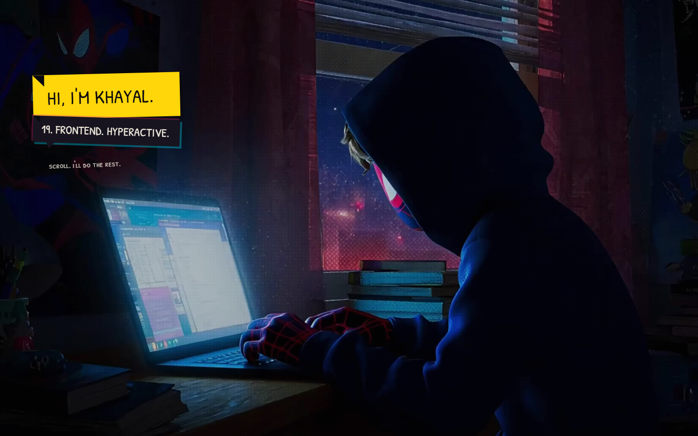

# KHAYAL VERSE

My portfolio, built as a one-page cinematic scroll story in Spider-Verse ink.

The scroll **is** the film: the wheel scrubs a pinned, muted video (never
autoplays, both directions), then drops you into one continuous comic world —
four chapter panels that expand into full issue spreads, a sketchbook journey,
skill variants from the multiverse, and a comic letter you can actually send.

## Stack

- React 19 + TypeScript + Vite 7 (single-file production build)
- Tailwind CSS 4 via `@tailwindcss/vite`
- Lenis smooth scroll — one master rAF, transform/opacity only
- Self-hosted fonts: Bangers, Patrick Hand SC, Archivo

## Run it

```
npm install
npm run dev      # dev server
npm run build    # production build → dist/
npm run preview
```

## Where things live

- `src/content/story.ts` — **every visible word on the site**, one
  `[EDIT ME]` constant per line. Change copy there, never in components.
- `src/engine/` — scroll store, scrub math, spring physics, video scrubber.
- `src/components/` — the film, the universe, journey, multiverse, contact,
  nav chrome and the surprise cameos.
- `public/` — fonts + hero video (encoded with dense keyframes so it scrubs
  smoothly).
- `PLAN.md` — my working checklist: design tokens, motion rules, media notes.

## Notes

- 60fps contract: read-then-write every frame, offscreen work parks,
  nothing animates but transform/opacity.
- `prefers-reduced-motion` respected globally — the scrub stays (it's your
  input), decorations go static.
- The contact form has no backend yet: set `CONTACT_ENDPOINT` in `story.ts`
  (e.g. a Formspree endpoint); until then it opens the visitor's mail app
  with the letter prefilled.

— [Khayal](https://t.me/morpheus2314)

---

## Screenshots

| Desktop | Mobile |
| :---: | :---: |
|  |  |

<p align="center">
  <a href="https://portfolio-2-inky-ten.vercel.app">Live site → https://portfolio-2-inky-ten.vercel.app</a>
</p>
