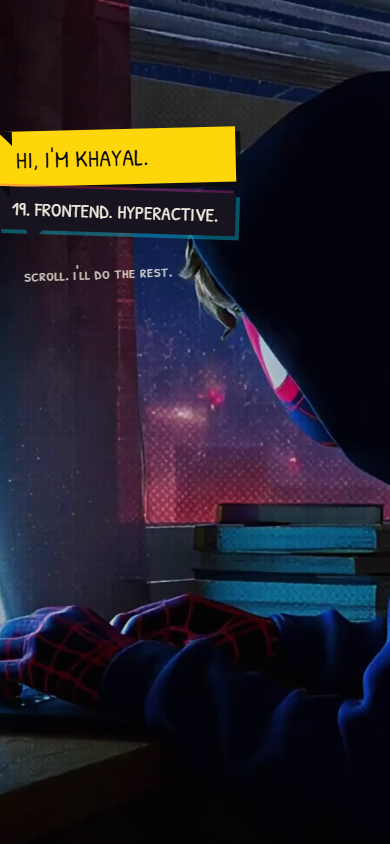

# Portfolio-2

"Khayal Verse" — my one-page cinematic portfolio in Spider-Verse comic style, where the scroll wheel scrubs a hero video and drives one continuous comic world.

**Live demo:** <https://portfolio-2-inky-ten.vercel.app>

<p align="center">
<div align="center">

| Desktop | Mobile |
|---|---|
|  |  |

</div>
</p>

## What it does

The scroll is the playhead: a master `requestAnimationFrame` loop in `src/engine/scroll.ts` reads the scroll offset and writes it to the hero video's `currentTime`, so the wheel scrubs the footage in both directions and nothing autoplays. Below the hero, four chapter panels expand into full comic spreads, followed by a sketchbook journey, skill variants and a contact letter. Every visible word lives in `src/content/story.ts` as one constant per line.

## Tech stack

React 19 · TypeScript · Vite 7 · Tailwind CSS 4 · Lenis

## Features

- Scroll-scrubbed hero video (dense-keyframe encoding, both directions, never autoplays)
- One master rAF loop; only `transform`/`opacity` animate to hold 60 fps
- Spring physics and scrub math isolated in `src/engine/`
- All copy centralized in `src/content/story.ts` — components never hardcode text
- Single-file production build via `vite-plugin-singlefile`
- `prefers-reduced-motion` respected globally

## Run locally

```bash
git clone https://github.com/Mister2314/Portfolio-2.git
cd Portfolio-2
npm install
npm run dev
```

Limitation: the contact form has no backend yet — it opens the visitor's mail app with the letter prefilled until `CONTACT_ENDPOINT` is set in `story.ts`.
